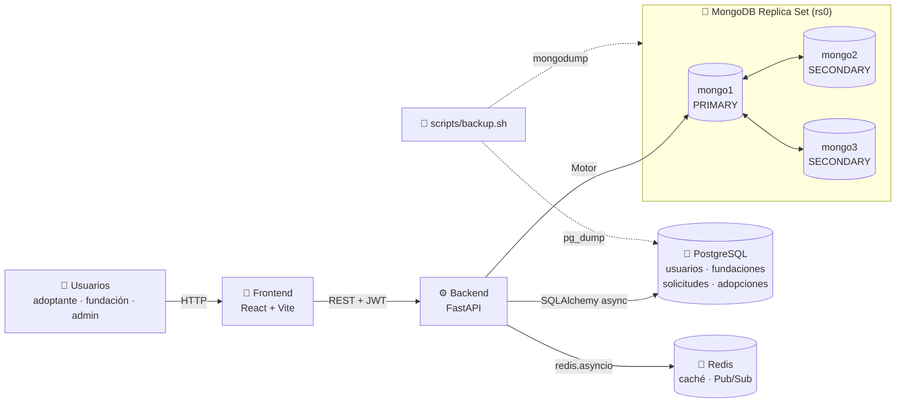

<div align="center">

# 🐾 MiMascota

**Plataforma web de adopción de mascotas que conecta fundaciones con adoptantes, con persistencia políglota.**


*Proyecto de la asignatura **Bases de Datos NoSQL**, Ingeniería de Sistemas, Universidad Distrital Francisco José de Caldas.*

</div>

---

## 📖 Descripción

MiMascota permite a las **fundaciones** publicar perfiles de mascotas en adopción y a los **adoptantes** buscarlas por especie y cercanía, enviar solicitudes y seguir su estado. El proyecto aplica **persistencia políglota**: cada tipo de dato se guarda en el motor que mejor se ajusta a él.

## 🗃️ Rol de cada base de datos

| Base de datos | Qué almacena | Por qué |
|---|---|---|
| 🍃 **MongoDB** (replica set de 3 nodos) | Perfiles de mascotas | Estructura variable según la especie, historial médico como documentos anidados y búsqueda geoespacial con índice `2dsphere`. Validación con `$jsonSchema`. |
| 🐘 **PostgreSQL** | Usuarios, fundaciones, solicitudes y adopciones | Integridad referencial (llaves foráneas, `CHECK`, índices únicos) y transacciones ACID al aprobar una adopción. |
| 🔴 **Redis** | Caché de búsquedas y notificaciones | Respuesta rápida a búsquedas repetidas (patrón *cache-aside* con TTL) y notificaciones en tiempo real con Pub/Sub. |

## ✨ Funcionalidades principales

- 🔐 Registro e inicio de sesión con **JWT** y tres roles: adoptante, fundación y administrador.
- 🏠 Gestión del perfil de cada fundación.
- 🐶 Registro de mascotas con atributos propios de cada especie e **historial médico**.
- 📍 **Búsqueda por cercanía** según la ubicación del adoptante, con filtros por especie y estado.
- 📝 **Solicitudes de adopción**: el adoptante las envía y la fundación las aprueba o rechaza.
- 🔔 **Notificaciones** a los usuarios cuando cambia el estado de una solicitud.
- ⚡ **Caché** de los resultados de búsqueda.
- 💾 **Respaldo y restauración** de las bases de datos.

## 🏗️ Arquitectura



## 📂 Estructura del repositorio

```
mi-mascota/
├── backend/                  # API REST (FastAPI)
│   ├── app/
│   │   ├── main.py           # App, CORS, routers y lifespan
│   │   ├── core/             # Configuración, seguridad (JWT, bcrypt) y roles
│   │   ├── api/routes/       # Endpoints: health, auth, users, foundations, pets, adoption-requests
│   │   ├── schemas/          # Modelos Pydantic v2
│   │   ├── services/         # Lógica de negocio
│   │   ├── db/
│   │   │   ├── mongo/        # Cliente Motor y colecciones
│   │   │   └── postgres/     # Sesiones async y modelos SQLAlchemy
│   │   ├── cache/            # Redis: caché de búsquedas y Pub/Sub
│   │   └── dependencies/     # Dependencias de FastAPI (BD, usuario actual, roles)
│   ├── alembic/              # Migraciones de PostgreSQL
│   ├── tests/                # Pruebas con pytest + httpx
│   ├── requirements.txt
│   ├── requirements-dev.txt
│   └── Dockerfile
├── frontend/                 # Interfaz web (React + Vite)
│   └── src/                  # pages/, components/, services/, hooks/
├── database/
│   ├── mongo/                # Replica set y colecciones con $jsonSchema
│   ├── postgres/init/        # schema.sql con tablas y restricciones
│   └── redis/                # redis.conf
├── scripts/                  # backup.sh y restore.sh
├── docs/                     # Anteproyecto y diagramas
├── docker-compose.yml
├── .env.example
└── README.md
```

## 🚀 Instalación y ejecución

### Requisitos

- [Docker](https://www.docker.com/) y Docker Compose v2
- [Git](https://git-scm.com/) (en Windows, Git Bash para los scripts de respaldo)
- Para desarrollo local opcional: Python 3.12 y Node.js 20

### Opción A: todo con Docker (recomendada)

1. **Clonar el repositorio**
   ```bash
   git clone <url-del-repositorio>
   cd mi-mascota
   ```

2. **Crear el archivo de entorno** y completar los valores vacíos (`JWT_SECRET_KEY`, `POSTGRES_PASSWORD`, `REDIS_PASSWORD`):
   ```bash
   cp .env.example .env
   ```
   Para generar una clave JWT segura:
   ```bash
   python -c "import secrets; print(secrets.token_urlsafe(64))"
   ```

3. **Levantar los servicios**
   ```bash
   docker compose up -d --build
   ```
   El servicio `mongo-setup` inicia el replica set y crea las colecciones; el backend arranca cuando termina.

4. **Verificar**
   ```bash
   docker compose ps
   curl http://localhost:8000/health
   ```

| Servicio | URL / puerto |
|---|---|
| Frontend | http://localhost:5173 |
| Backend (API) | http://localhost:8000 |
| Documentación de la API | http://localhost:8000/docs |
| PostgreSQL | `localhost:5432` |
| MongoDB | `localhost:27017`, `27018`, `27019` |
| Redis | `localhost:6379` |

Para detener todo: `docker compose down` (añade `-v` para **borrar también los datos**).

### Opción B: backend en local con entorno virtual

Útil para depurar el backend. Las bases siguen corriendo en Docker:

```bash
# 1. Levantar solo las bases de datos
docker compose up -d postgres mongo1 mongo2 mongo3 mongo-setup redis

# 2. Crear y activar el entorno virtual
cd backend
python -m venv .venv
.venv\Scripts\activate          # Windows
# source .venv/bin/activate     # Linux / macOS

# 3. Instalar dependencias y ejecutar
pip install -r requirements-dev.txt
uvicorn app.main:app --reload

# 4. Ejecutar las pruebas
pytest
```

> El backend lee el `.env` de la raíz. Desde el host se conecta a MongoDB con `directConnection=true` al nodo `mongo1`, que tiene mayor prioridad y normalmente es el primario.

El frontend también puede correrse en local con `cd frontend && npm install && npm run dev`.

## 📑 Documentación de la API

FastAPI genera la documentación automáticamente a partir del código:

- **Swagger UI**: http://localhost:8000/docs (permite probar los endpoints, incluido el login con JWT desde el botón *Authorize*).
- **ReDoc**: http://localhost:8000/redoc
- **Esquema OpenAPI**: http://localhost:8000/openapi.json

El endpoint `GET /health` verifica la conexión con PostgreSQL, MongoDB y Redis: responde `200` si las tres responden y `503` si alguna falla.

## 🛡️ Seguridad y gestión

| Aspecto | Implementación |
|---|---|
| **Autenticación** | JWT firmados (HS256) con `python-jose`; el token incluye el id y el rol del usuario y tiene expiración. |
| **Contraseñas** | Hash con bcrypt (`passlib`); nunca se guardan en texto plano. |
| **Autorización por roles** | Adoptante, fundación y administrador. Las rutas se protegen con la dependencia `require_roles(...)`. |
| **Validación de datos** | Pydantic v2 en la API y `$jsonSchema` en MongoDB; restricciones `CHECK`, `UNIQUE` y llaves foráneas en PostgreSQL. |
| **Alta disponibilidad** | Replica set de MongoDB con 3 nodos (1 primario y 2 secundarios con elección automática). |
| **Transacciones** | La aprobación de una solicitud y el registro de la adopción se hacen en una sola transacción de PostgreSQL. |
| **Respaldos** | `scripts/backup.sh` (`pg_dump` + `mongodump`) y `scripts/restore.sh` (`pg_restore` + `mongorestore`). |
| **Secretos** | Variables de entorno en `.env`, excluido de Git; `.env.example` sirve de plantilla. |

### Respaldo y restauración

```bash
./scripts/backup.sh                              # crea backups/<fecha_hora>/
./scripts/restore.sh backups/20260101_120000     # restaura (pide confirmación)
```

## 👥 Autores

- **Andrés Felipe Ruiz Vasallo**
- **Catalina Ariza Ardila**
- **Alejandro Nuñez Barrera**

**Docente:** Lilia Marcela Espinosa Rodríguez

---

<div align="center">
Universidad Distrital Francisco José de Caldas · Ingeniería de Sistemas · Bases de Datos NoSQL
</div>
