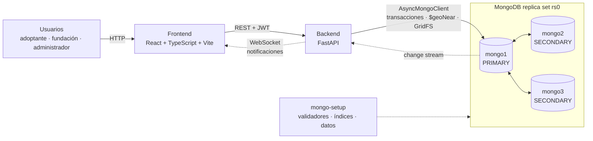

<div align="center">

# MiMascota

**Plataforma web de adopción de mascotas que conecta fundaciones de Bogotá con personas que quieren adoptar.**


*Proyecto final de **Bases de Datos NoSQL**, Ingeniería de Sistemas, Universidad Distrital Francisco José de Caldas.*

</div>

---

## Descripción

En MiMascota participan tres roles:

| Rol | Qué hace |
|---|---|
| **Fundación** | Publica a sus mascotas con fotos, atributos propios de cada especie e historial médico, y aprueba o rechaza las solicitudes que recibe. |
| **Adoptante** | Completa un perfil de estilo de vida, busca mascotas por filtros o por cercanía, recibe recomendaciones con porcentaje de compatibilidad y sigue el estado de sus solicitudes. |
| **Administrador** | Valida las fundaciones antes de que puedan publicar y activa o desactiva cuentas. |

Toda la información vive en **MongoDB**, desplegado como replica set de tres nodos. El proyecto aprovecha lo que ofrece una base documental:

- documentos con estructura variable;
- arreglos embebidos;
- consultas geoespaciales;
- transacciones multidocumento;
- change streams para las notificaciones en tiempo real;
- GridFS para las fotos.

## Funcionalidades

- Registro e inicio de sesión con **JWT** y tres roles; las fundaciones quedan pendientes hasta que el administrador las valida.
- **Catálogo** con filtros por especie, tamaño, edad y temperamento, y **búsqueda por cercanía** (`$geoNear`) en lista o mapa.
- **Recomendaciones** con porcentaje de compatibilidad y razones, calculadas a partir del perfil de estilo de vida.
- **Solicitudes de adopción** con historial de estados. Al aprobar una, una **transacción** rechaza las demás pendientes y marca la mascota como adoptada.
- Gestión de mascotas con formulario según la especie, **historial médico** y fotos.
- **Notificaciones en tiempo real** por WebSocket, alimentadas por un change stream, con historial.
- Validación de fundaciones y **borrado lógico** de usuarios.
- **Respaldo y restauración** con `mongodump` y `mongorestore`.

## Arquitectura



| Componente | Detalle | Documentación |
|---|---|---|
| Base de datos | 5 colecciones con validación `$jsonSchema`, 17 índices (2dsphere, únicos, parciales y multikey), GridFS y datos de prueba | [database/README.md](database/README.md) |
| Backend | FastAPI asíncrono organizado por módulos | [backend/README.md](backend/README.md) |
| Frontend | 15 pantallas, sistema de diseño propio y modo mock opcional | [frontend/README.md](frontend/README.md) |

## Puesta en marcha

### Requisitos

- [Docker Desktop](https://www.docker.com/) con Docker Compose v2.
- [Git](https://git-scm.com/). En Windows, Git Bash para los scripts de respaldo.
- Opcional, para desarrollo local: Python 3.12 y Node.js 20.

### Pasos

1. **Clonar el repositorio**
   ```bash
   git clone <url-del-repositorio>
   cd mi-mascota
   ```

2. **Crear el archivo de entorno** y definir `JWT_SECRET_KEY`:
   ```bash
   cp .env.example .env
   python -c "import secrets; print(secrets.token_urlsafe(64))"   # copie el resultado en JWT_SECRET_KEY
   ```

3. **Levantar todo**
   ```bash
   docker compose up -d --build
   ```
   La primera vez, `mongo-setup` inicia el replica set y crea las colecciones, los validadores, los índices y los datos de prueba. En los arranques siguientes detecta que la base existe y **conserva los datos**.

4. **Abrir** http://localhost:5173 e ingresar con una cuenta de prueba.

| Servicio | Dirección |
|---|---|
| Frontend | http://localhost:5173 |
| API | http://localhost:8000/api |
| Documentación de la API (Swagger) | http://localhost:8000/docs |
| WebSocket de notificaciones | `ws://localhost:8000/ws/notificaciones` |
| MongoDB | `localhost:27017`, `27018`, `27019` |

Comandos útiles:

| Comando | Para qué sirve |
|---|---|
| `docker compose ps` | Ver el estado de los servicios |
| `docker compose logs -f backend` | Seguir el registro del backend |
| `docker compose logs mongo-setup` | Ver la preparación de la base |
| `docker compose down` | Detener todo y conservar los datos |
| `docker compose down -v` | Detener y **borrar** los datos; el siguiente `up` recrea la base desde cero |

### Cuentas de prueba

Todas usan la contraseña **`MiMascota2026`**.

| Rol | Correo |
|---|---|
| Adoptante | `adoptante@mimascota.co` |
| Fundación | `fundacion@mimascota.co` |
| Administrador | `admin@mimascota.co` |
| Fundación pendiente de validación | `hola@bigotesteusaquillo.org` |
| Fundación rechazada | `refugiodelsur@correo.co` |

### Desarrollo sin Docker para el código

Las bases pueden seguir en Docker mientras el backend y el frontend corren en local, con recarga en caliente:

```bash
docker compose up -d mongo1 mongo2 mongo3 mongo-setup

# Backend
cd backend
python -m venv .venv
.venv\Scripts\activate          # Windows (en Linux o macOS: source .venv/bin/activate)
pip install -r requirements-dev.txt
uvicorn app.main:app --reload

# Frontend (otra terminal)
cd frontend && npm install && npm run dev
```

Si el frontend local ya ocupa el puerto 5173, levante el resto sin él (`docker compose up -d backend`) o cambie `FRONTEND_PORT` en el `.env`.

## Estructura del repositorio

```
mi-mascota/
├── backend/               API FastAPI: módulos por recurso, tiempo real y pruebas de integración
├── frontend/              React + TypeScript: 15 pantallas por rol
├── database/mongo/        Replica set, validadores $jsonSchema, índices y datos de prueba
├── scripts/               backup.sh y restore.sh (mongodump / mongorestore)
├── docs/                  Anteproyecto y diagramas
├── docker-compose.yml     mongo1-3, mongo-setup, backend y frontend
└── .env.example           Plantilla de variables de entorno
```

## Seguridad y operación

| Aspecto | Implementación |
|---|---|
| Autenticación | JWT HS256 con el id y el rol del usuario, con vencimiento |
| Contraseñas | Hash bcrypt; la API nunca devuelve el hash |
| Autorización | Dependencias de FastAPI por rol. Las escrituras de una fundación exigen que esté aprobada. |
| Validación | Pydantic en la API y `$jsonSchema` estricto en cada colección |
| Integridad | Índices únicos (correo, NIT, una solicitud pendiente por adoptante y mascota) y transacciones multidocumento |
| Alta disponibilidad | Replica set de 3 nodos con elección automática de primario |
| Respaldos | `./scripts/backup.sh` crea `backups/<fecha_hora>/mongo.archive.gz`; `./scripts/restore.sh <carpeta>` lo restaura (pide confirmación) |
| Secretos | Variables en `.env`, excluido de Git |
