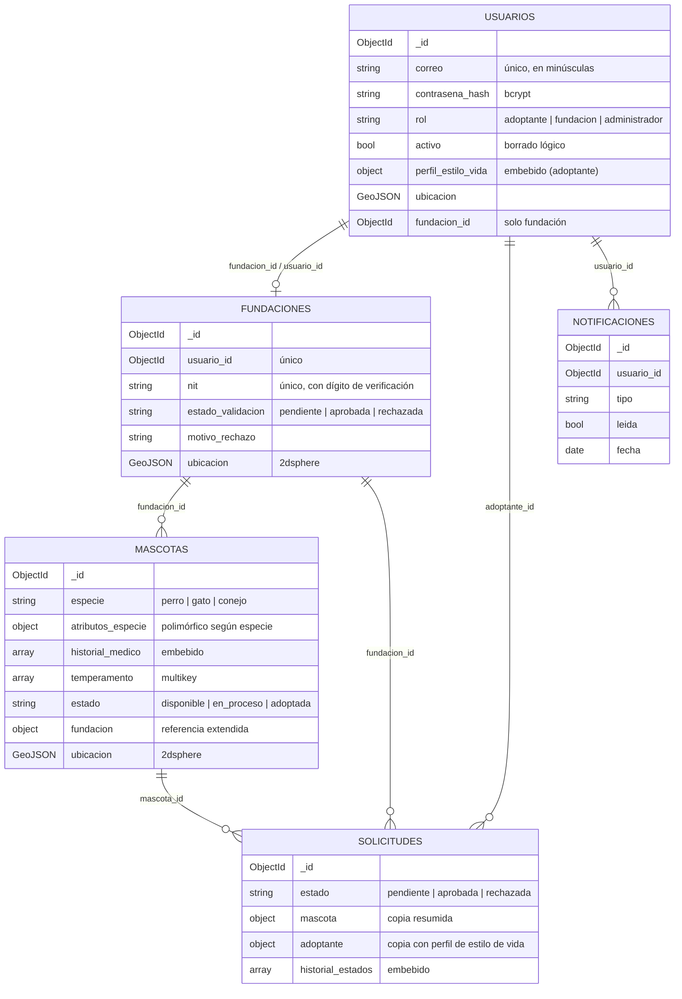

# MiMascota · Base de datos (MongoDB)

Diseño e implementación de la base de datos documental de MiMascota. Todo el aplicativo usa **MongoDB 7** desplegado como **replica set de 3 nodos** (`rs0`). La base se llama `mimascota` y tiene cinco colecciones, más un bucket de GridFS para las fotos.

## Contenido

1. [Despliegue: primer arranque y arranques siguientes](#despliegue-primer-arranque-y-arranques-siguientes)
2. [Modelo de documentos](#modelo-de-documentos)
3. [Colecciones](#colecciones)
4. [Patrones de modelado](#patrones-de-modelado)
5. [Validación con $jsonSchema](#validación-con-jsonschema)
6. [Índices](#índices)
7. [Consistencia: transacciones e índices únicos](#consistencia-transacciones-e-índices-únicos)
8. [Tiempo real con change streams](#tiempo-real-con-change-streams)
9. [Fotos con GridFS](#fotos-con-gridfs)
10. [Datos de prueba](#datos-de-prueba)
11. [Consultas útiles](#consultas-útiles)

## Estructura de la carpeta

```
database/
└── mongo/
    ├── replica-set/init-replica.sh   Inicia el replica set y ejecuta setup.js
    ├── setup.js                      Colecciones, validadores, índices y datos (idempotente)
    ├── validators/                   Un $jsonSchema por colección (JSON)
    │   ├── _comunes.json             Fragmentos reutilizados: geoPunto, perfilEstiloVida, correo, teléfono
    │   ├── usuarios.json
    │   ├── fundaciones.json
    │   ├── mascotas.json
    │   ├── solicitudes.json
    │   └── notificaciones.json
    ├── indexes/indices.json          Índices de cada colección y la consulta que atienden
    └── seed/datos.json               Datos de prueba en Extended JSON
```

## Despliegue: primer arranque y arranques siguientes

`docker compose up -d --build` levanta los nodos `mongo1`, `mongo2` y `mongo3`. Cuando los tres responden, el servicio de un solo uso `mongo-setup` ejecuta `replica-set/init-replica.sh`:

1. Si el replica set no existe, lo inicia con los tres nodos (`mongo1` con prioridad 2, para que normalmente sea el primario) y espera a que haya un primario.
2. Ejecuta `setup.js` sobre el replica set:
   - **Colecciones**: las crea con su validador `$jsonSchema` (`validationLevel: strict`, `validationAction: error`). Si ya existen, actualiza el validador con `collMod`.
   - **Índices**: los crea con `createIndex`, que no duplica los que ya existen.
   - **Datos**: carga los datos de prueba **solo si la colección `usuarios` está vacía**.

| Situación | Resultado |
|---|---|
| Primer arranque (volúmenes vacíos) | Crea el replica set, las colecciones, los índices y los datos de prueba |
| Arranques siguientes | Detecta lo existente y **conserva los datos**; solo reaplica validadores e índices |
| Reiniciar desde cero | `docker compose down -v` borra los volúmenes; el siguiente `up` vuelve a crear todo |

El backend (`depends_on: service_completed_successfully`) solo arranca cuando `mongo-setup` termina sin errores. Si un documento de prueba no cumple su validador, el arranque se detiene y el error queda en `docker compose logs mongo-setup`.

## Modelo de documentos



Criterio general: **se embebe lo que se lee siempre junto con su documento padre** (perfil, historial médico, historial de estados) y **se referencia lo que tiene vida propia** (usuarios, fundaciones, mascotas). Donde una pantalla necesita datos de otra colección en cada lectura, se guarda una copia acotada en lugar de hacer `$lookup`.

## Colecciones

### `usuarios`
Cuentas de los tres roles. El rol decide qué campos son válidos (ver `oneOf` en el validador):

| Rol | Campos propios |
|---|---|
| `adoptante` | `perfil_estilo_vida` (opcional hasta completar el asistente), `ubicacion` |
| `fundacion` | `fundacion_id` (obligatorio), sin perfil |
| `administrador` | ni perfil ni fundación |

- **Contraseñas**: se guarda `contrasena_hash` (bcrypt), nunca la contraseña. La API no expone el hash.
- **Desactivación**: `activo: false` es un borrado lógico; el documento y sus relaciones se conservan.

### `fundaciones`
Datos verificables de cada fundación, enlazados 1:1 con su cuenta (`usuario_id` único).

- `estado_validacion` sigue el ciclo `pendiente → aprobada | rechazada`. El validador exige coherencia:
  - **pendiente**: sin `fecha_validacion` ni `motivo_rechazo`.
  - **aprobada**: con `fecha_validacion`.
  - **rechazada**: con `fecha_validacion` y `motivo_rechazo`.
- El NIT se normaliza a `000.000.000-0` y el backend verifica el dígito de verificación (algoritmo de la DIAN).

### `mascotas`
Publicaciones de adopción.

- `atributos_especie` cambia de forma según la especie (ver [patrón polimórfico](#patrones-de-modelado)).
- `historial_medico` es un arreglo embebido, ordenado del registro más reciente al más antiguo. Cada registro tiene su propio `_id`.
- `estado` lo cambian solo las reglas de las solicitudes:

  | Evento | Cambio de estado |
  |---|---|
  | Primera solicitud pendiente | `disponible` → `en_proceso` |
  | Solicitud aprobada | → `adoptada` |
  | Rechazo de la última solicitud pendiente | `en_proceso` → `disponible` |

### `solicitudes`
Solicitudes de adopción con su historial completo. Guardan copias de la mascota, la fundación y el adoptante, este último con su perfil de estilo de vida tal como estaba al enviar la solicitud, para que la fundación evalúe con la misma información que vio el adoptante.

### `notificaciones`
Avisos por usuario (`tipo`, `titulo`, `mensaje`, `enlace`, `leida`). Cada inserción se emite por WebSocket mediante un change stream.

## Patrones de modelado

| Patrón | Dónde | Por qué |
|---|---|---|
| **Documento embebido** | `usuarios.perfil_estilo_vida`, `mascotas.historial_medico`, `solicitudes.historial_estados` | Se leen y escriben siempre con su padre; tienen pocos elementos. El historial médico crece con `$push` + `$sort` en una sola operación atómica. |
| **Polimórfico** | `mascotas.atributos_especie` | Un perro tiene nivel de energía y necesidad de patio; un gato, arenero; un conejo, tipo de pelaje. Una sola colección permite un catálogo con filtros comunes, y el validador garantiza la forma correcta para cada especie. |
| **Referencia extendida** | `mascotas.fundacion` (`_id`, nombre, localidad, contacto) | El catálogo y el detalle muestran la fundación sin `$lookup`. Son datos que casi no cambian. |
| **Subconjunto / copia** | `solicitudes.mascota`, `solicitudes.adoptante`, `solicitudes.fundacion` | La bandeja de la fundación muestra todo sin consultar tres colecciones. Si el adoptante cambia su nombre o teléfono, o la fundación edita la mascota, el backend actualiza las copias con `update_many`. |
| **Referencia** | `*_id` entre colecciones | Para entidades con ciclo de vida propio y relaciones de uno a muchos sin límite. |
| **Borrado lógico** | `usuarios.activo` | Desactivar una cuenta no rompe las solicitudes ni el historial. |

## Validación con $jsonSchema

Cada colección tiene `additionalProperties: false`: no se aceptan campos que no estén en el diseño. Además de tipos, rangos, longitudes y expresiones regulares, los validadores usan combinadores de JSON Schema para reglas que dependen de otro campo:

- `usuarios`: `oneOf` por rol.
- `fundaciones`: `oneOf` por estado de validación.
- `mascotas`: `oneOf` que asocia cada `especie` con la forma exacta de `atributos_especie`.

Los fragmentos repetidos (punto GeoJSON, perfil de estilo de vida, correo y teléfono) viven en `_comunes.json`; `setup.js` reemplaza cada `{ "$incluir": "nombre" }` por su definición antes de enviarlo a MongoDB.

Ejemplos de rechazos que se verificaron:

| Intento | Resultado |
|---|---|
| Perro con atributos de gato | `Document failed validation` |
| Fundación rechazada sin motivo | `Document failed validation` |
| Cuenta de fundación sin `fundacion_id` | `Document failed validation` |
| NIT con formato inválido | `Document failed validation` |
| Temperamento fuera de la lista | `Document failed validation` |
| Correo duplicado | `E11000 duplicate key` (índice único) |
| Segunda solicitud pendiente del mismo adoptante para la misma mascota | `E11000 duplicate key` (índice único parcial) |

## Índices

Definidos en `indexes/indices.json`, cada uno con la consulta que atiende:

| Colección | Índice | Consulta |
|---|---|---|
| usuarios | `correo` (único) | Inicio de sesión y registro |
| usuarios | `rol, activo, fecha_registro` | Listado del administrador |
| usuarios | `fundacion_id` (único parcial) | Cuenta de cada fundación |
| fundaciones | `usuario_id` (único) | `GET /fundaciones/me` |
| fundaciones | `nit` (único) | NIT sin duplicados |
| fundaciones | `estado_validacion, fecha_registro` | Bandeja de validación |
| fundaciones | `ubicacion` (2dsphere) | Ubicación de la sede |
| mascotas | `ubicacion` (2dsphere) | Búsqueda por cercanía con `$geoNear` |
| mascotas | `estado, especie, tamano, fecha_publicacion` | Catálogo filtrado y ordenado |
| mascotas | `temperamento` (multikey) | Filtro `$all` por temperamento |
| mascotas | `fundacion_id, estado, fecha_publicacion` | Gestión e indicadores de la fundación |
| solicitudes | `mascota_id, adoptante_id` (único parcial con `estado: pendiente`) | Impide solicitudes pendientes duplicadas |
| solicitudes | `mascota_id, estado` | Rechazo automático al aprobar |
| solicitudes | `fundacion_id, estado, fecha_actualizacion` | Bandeja de la fundación |
| solicitudes | `adoptante_id, fecha_actualizacion` | Mis solicitudes |
| notificaciones | `usuario_id, fecha` | Historial |
| notificaciones | `usuario_id, leida` | Contador de no leídas |

## Consistencia: transacciones e índices únicos

El replica set permite **transacciones multidocumento**. El backend las usa cuando una operación toca varios documentos que deben quedar coherentes:

| Operación | Documentos en la misma transacción |
|---|---|
| Registro de una fundación | Usuario + fundación + notificación a cada administrador |
| Envío de una solicitud | Solicitud + mascota a `en_proceso` + notificación a la fundación |
| **Aprobación de una solicitud** | Solicitud aprobada + demás pendientes rechazadas + mascota `adoptada` + notificación a cada adoptante |
| Rechazo de una solicitud | Solicitud + mascota de vuelta a `disponible` (si no quedan pendientes) + notificación |
| Validación de una fundación | Fundación + notificación a su cuenta |

Si cualquier paso falla, no se guarda ninguno. Las condiciones de carrera se cubren con filtros condicionales (por ejemplo, `{ _id, estado: "pendiente" }` al resolver) y con el índice único parcial de solicitudes pendientes.

## Tiempo real con change streams

El backend abre un **change stream** sobre `notificaciones` (`operationType: insert`) al iniciar. Cada notificación insertada se reenvía por WebSocket (`/ws/notificaciones`) a las pestañas abiertas de su destinatario. Las notificaciones creadas dentro de una transacción llegan al confirmarse, nunca antes. Si el flujo se interrumpe, el backend lo reanuda desde el último evento con su `resume token`. Los change streams solo existen en replica sets: esta es una de las razones del despliegue con tres nodos.

## Fotos con GridFS

Las fotos que suben las fundaciones se guardan en el bucket **`fotos`** (colecciones `fotos.files` y `fotos.chunks`), con metadatos del tipo de imagen y de la fundación. `POST /api/mascotas/fotos` devuelve una URL `GET /api/fotos/{id}` que se guarda en `mascotas.fotos`. Así las imágenes quedan en la misma base, se replican en los tres nodos y entran en los respaldos de `mongodump`. Las fotos de los datos de prueba son URLs públicas.

## Datos de prueba

`seed/datos.json` está en **Extended JSON** (`{"$oid": ...}`, `{"$date": ...}`), así que se cargan como `ObjectId` y `Date` reales. Son los mismos datos del modo mock del frontend. Las fechas se desplazan al momento del primer arranque, de modo que "hace 3 días" sea relativo a cuando se creó la base.

| Colección | Documentos | Contenido |
|---|---|---|
| usuarios | 13 | 1 administrador, 5 adoptantes (uno inactivo), 7 cuentas de fundación |
| fundaciones | 7 | 4 aprobadas, 2 pendientes y 1 rechazada, en localidades reales de Bogotá |
| mascotas | 24 | Perros, gatos y conejos con historial médico, en coordenadas reales |
| solicitudes | 10 | Pendientes, aprobadas y rechazadas (incluido un rechazo automático) |
| notificaciones | 26 | Coherentes con las solicitudes y validaciones anteriores |

Todas las cuentas usan la contraseña **`MiMascota2026`**:

| Rol | Correo |
|---|---|
| Adoptante | `adoptante@mimascota.co` |
| Fundación aprobada | `fundacion@mimascota.co` |
| Administrador | `admin@mimascota.co` |
| Fundación pendiente | `hola@bigotesteusaquillo.org` |
| Fundación rechazada | `refugiodelsur@correo.co` |
| Adoptante inactivo | `mariana.lozano@correo.co` |

## Consultas útiles

Abra una consola con:

```bash
docker compose exec mongo1 mongosh mimascota
```

```js
// Estado del replica set
rs.status().members.map((m) => `${m.name} ${m.stateStr}`)

// Validador de una colección
db.getCollectionInfos({ name: "mascotas" })[0].options.validator

// Mascotas a menos de 5 km de Chapinero, de la más cercana a la más lejana
db.mascotas.aggregate([
  { $geoNear: { near: { type: "Point", coordinates: [-74.0636, 4.6534] }, distanceField: "metros", maxDistance: 5000, query: { estado: { $ne: "adoptada" } } } },
  { $project: { nombre: 1, especie: 1, metros: { $round: ["$metros", 0] } } }
])

// Mascotas por estado en cada fundación
db.mascotas.aggregate([{ $group: { _id: { fundacion: "$fundacion.nombre", estado: "$estado" }, total: { $sum: 1 } } }])

// Plan de ejecución: el catálogo usa el índice compuesto
db.mascotas.find({ estado: "disponible", especie: "perro" }).sort({ fecha_publicacion: -1 }).explain("queryPlanner").queryPlanner.winningPlan
```
